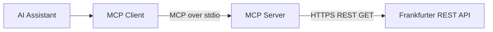

# Currency Converter MCP

This Python server exposes one tool, `convert_currency`, using the official MCP Python SDK v2. Its high-level server class, `MCPServer`, is the successor to `FastMCP`.

## Architecture



- **MCP** is the Model Context Protocol. It standardizes how an AI application discovers and calls tools.
- **An MCP client** connects to a server, lists available tools and sends tool calls. In a demo, Inspector acts as the client.
- **An MCP server** publishes capabilities. Here it runs as a local Python process and exchanges MCP messages over standard input and output.
- **An MCP tool** is a callable operation with a name, description and input schema. This server exposes `convert_currency` with a number and two currency codes.

The server is an integration adapter. It receives an MCP tool call, validates and normalizes the inputs, then uses `httpx` to send an HTTPS GET to Frankfurter's REST endpoint, `/v2/rate/{FROM}/{TO}`. Frankfurter returns a JSON object with `base`, `quote`, `rate` and `date`. The server multiplies the amount by the rate and formats the converted amount to two decimal places for the demo. The date belongs to the latest available reference rate. Trading quotes may differ. A same-currency conversion uses the identity rate of 1 and skips the API call.

## Install and run

Open this folder in VS Code and run these commands in its PowerShell terminal. Use Python 3.14 for the tested setup. Install Node.js for Inspector. The browser demo below uses Inspector's maintained v1 line, which supports the workspace's Node.js version.

```powershell
py -3.14 -m venv .venv
.\.venv\Scripts\python.exe -m pip install -r requirements.txt
.\.venv\Scripts\python.exe -m pytest -q
```

To run the server directly:

```powershell
.\.venv\Scripts\python.exe server.py
```

The server waits for MCP messages on stdin. Press Ctrl+C to stop it before starting Inspector, which launches its own server process. The automated tests use mocked HTTP responses and work offline once dependencies are installed.

## Demonstrate with MCP Inspector

From the project folder:

```powershell
$pythonExe = (Resolve-Path .\.venv\Scripts\python.exe).Path
$serverPath = (Resolve-Path .\server.py).Path.Replace('\', '/')
npx.cmd --yes --cache .npm-cache @modelcontextprotocol/inspector@v1-latest $pythonExe $serverPath
```

1. Open the authenticated localhost URL printed in the terminal if the browser does not open automatically.
2. Select **STDIO**. Verify that **Command** points to the virtual environment's `python.exe` and **Arguments** contains the full path to `server.py` with forward slashes. If the script path contains spaces, enclose it in double quotes in the **Arguments** field. Click **Connect**.
3. Open **Tools**, click **List Tools**, and select `convert_currency`.
4. Set `amount` to `100`, `from_currency` to `USD` and `to_currency` to `EUR`. Click **Run Tool**.

Example input:

```json
{"amount": 100, "from_currency": "USD", "to_currency": "EUR"}
```

Example output using the reference rate published on November 17, 2026. A new call may return a different rate and date.

```text
100.0 USD = 90.85 EUR
Exchange rate: 1 USD = 0.90846 EUR
Exchange-rate date: 2026-11-17
Latest available Frankfurter reference rate. Trading quotes may differ.
```

## Optional Codex connection

To enable this server in a trusted Codex project, add this block to the project's `.codex/config.toml`. For another checkout, replace both absolute paths. The paths are single-quoted TOML strings so Windows backslashes are literal.

```toml
[mcp_servers.currency_converter]
command = 'C:\Users\User\OneDrive\Documents\ChatGPT\currency-converter-mcp\.venv\Scripts\python.exe'
args = ['C:\Users\User\OneDrive\Documents\ChatGPT\currency-converter-mcp\server.py']
```

Restart Codex to load the configuration and check `/mcp` for `currency_converter`. In that project, ask “Convert 100 USD to EUR using my currency converter tool.” Codex acts as the AI host and uses its MCP client to call the separate Python server. See the [Codex MCP setup guide](https://learn.chatgpt.com/docs/extend/mcp?surface=cli).

## Common problems

| Symptom | What to check |
| --- | --- |
| Python reports a missing module | Install `requirements.txt` using the same virtual environment Python that launches the server. |
| PowerShell blocks an npm script | Use `npx.cmd` as shown above. |
| Inspector cannot connect | Stop the previous Inspector with Ctrl+C, keep the new terminal session running, and open its full authenticated URL in a private browser window to start with fresh browser settings. Confirm STDIO and both absolute paths. |
| Python starts but says it can't open the script | Use forward slashes in the Inspector **Arguments** field. Inspector v1 interprets bare backslashes there as escapes. |
| Frankfurter has no rate for the pair | Check both codes and try a known pair such as USD/EUR or EUR/GBP. |
| Frankfurter times out or cannot be reached | Check DNS and HTTPS access to `api.frankfurter.dev`. The local tests can still run offline. |

## Two-minute explanation

“My project is a small integration adapter between an AI application and an external exchange-rate service. MCP is the protocol the application uses to discover and call my tool. The application's MCP client starts the Python server and communicates with it over standard input and output. For this demonstration, Inspector acts as the MCP client so we can see the tool and the result directly.

When I click List Tools, the server publishes one tool called `convert_currency`. Its schema tells the client to send a number and two currency-code strings. I enter 100, USD and EUR. The server checks that the amount is finite and non-negative, trims the codes, converts them to uppercase and validates them against ISO 4217.

The next connection uses HTTPS and REST. The server requests a USD/EUR quote from Frankfurter, reads the rate and the date from JSON, and multiplies 100 by that rate. It displays the converted amount, the reference rate and its date. If the two codes are the same, the amount stays unchanged and the server skips Frankfurter. If Frankfurter fails, the client receives a tool error. The pytest suite simulates those cases without an internet connection.”

[Official MCP Python SDK](https://github.com/modelcontextprotocol/python-sdk) · [Frankfurter v2 documentation](https://frankfurter.dev/#rate) · [MCP Inspector documentation](https://github.com/modelcontextprotocol/inspector)
